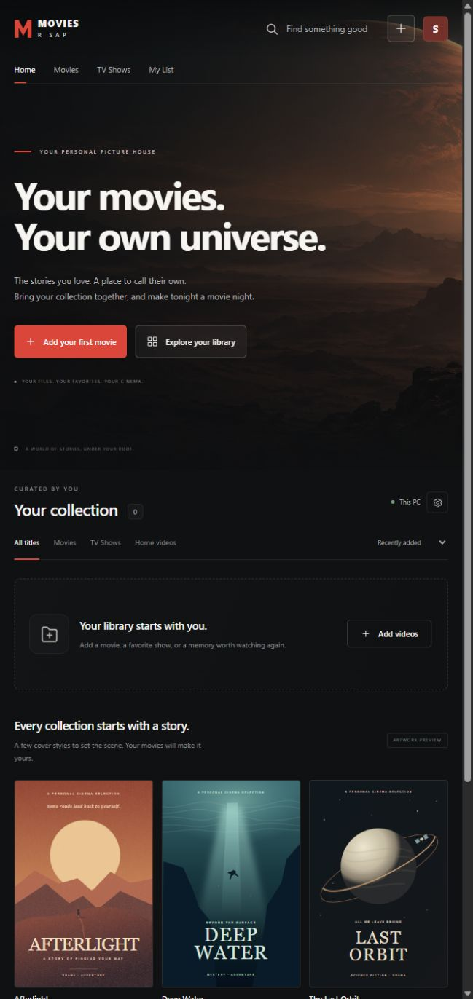

# Movies R Sap

Your movies. Your own universe. A personal Windows desktop cinema with a Netflix-inspired library, your own files, and room to grow into a home server.



Built with **Electron, Node.js, SQLite, and plain JavaScript/HTML/CSS**. The desktop app embeds a local backend, stores video files on disk, and keeps library metadata and playback progress in SQLite.

## Run from source

Use Windows with Node.js 24.11 or later and npm. From a terminal:

```powershell
git clone https://github.com/Sapri-S/movies-r-sap.git
cd movies-r-sap
npm ci
npm run desktop
```

The repository contains source code, artwork, and tests. Create the portable Windows application folder with `npm run package:win`; packaged executables and personal libraries are excluded from Git.

## Open the desktop app

After packaging, double-click **Start Movies R Sap.cmd**, or open **release/Movies R Sap-win32-x64/Movies R Sap.exe**.

The packaged desktop app includes its runtime. You do not need Node.js, a browser, or a terminal to use it. Keep the entire packaged application folder together; the executable depends on the supporting files beside it. Closing the app also stops its private local backend.

This is a local portable build, not a signed installer. No cloud account is needed. Phones, TVs, and other computers are outside this release.

## Your library

- Add one or more videos using **Add videos** or drag them onto its upload area.
- Browse Movies, TV Shows, and Home videos. Search, sort, edit details, and set cover artwork.
- Match uploaded files to movie names and local posters from an offline CSV catalog.
- Use **My List**, play videos, and return to saved playback positions.
- Automatic thumbnails are generated when the video can be decoded.
- Create a compatible MP4 copy of an MKV or another uploaded video, with conversion progress and cancellation.
- Uploads copy files into app-managed storage; original files stay untouched.
- Removing a movie explicitly deletes its app-managed copy and metadata.

The desktop library is stored under `%APPDATA%\Movies R Sap\library`. **Library settings** shows the actual location and storage use. Keeping videos outside the application folder lets updates preserve your collection.

The optional browser version stores a separate library in the project's `data` folder by default. Desktop and browser libraries are not opened simultaneously against one database. To relocate a library, stop both versions first and copy the complete library folder to the target location before opening it.

## Offline movie names and posters

Open **Library settings → Offline catalog** to import a UTF-8 CSV. Only `title` is required. Optional columns are `id`, `year`, `description`, `genre`, and `poster_filename`. Download the CSV template from that screen for an example. Imports merge entries by stable ID and leave other catalog rows in place; keep an ID unchanged when editing a row. When no ID is supplied, it is derived from the title and year. Limits are 20 MB per file and 50,000 catalog entries.

Posters are separate local JPG, PNG, or WebP files, up to 10 MB each. Set `poster_filename` to an image's filename (for example `my-movie-1999.jpg`), then choose that image through **Choose poster images**. Filenames are case insensitive; folders and web addresses are not accepted. The app does not download images from CSV URLs.

After uploading a video, open its details and choose **Match from catalog**. Type its real movie name, check the year, select a result, then choose **Apply this match**. The available name, year, description, and poster update together; missing fields preserve your existing details. Your video, category, My List, and watch progress stay saved. **Edit details** and **Change cover** remain available afterward. A filename such as `A1 T00` cannot identify the movie by itself. Importing a catalog does not add thousands of playable movies to your library.

For a starter list, the optional PowerShell helper downloads the official [GroupLens MovieLens small dataset](https://grouplens.org/datasets/movielens/latest/) and prepares a compatible CSV:

```powershell
./scripts/prepare-movielens-catalog.ps1
```

Then import `catalog-imports/movies.csv` through the app. The dataset currently provides 9,742 movie names, years, and genres, with no posters or plots. It was generated in 2018, so add newer titles yourself. The helper preserves the original license and attribution in `catalog-imports/MovieLens-README.txt`; its research-use terms restrict commercial or revenue-bearing use without permission. The data is optional, excluded from Git and the desktop package, and is not automatically downloaded by the app. Internet is needed to run this helper once; catalog imports, matching, and poster display run locally.

## Picture size and fullscreen

The player offers **Fit**, **Fill**, and **Full screen** controls. Fit preserves the entire frame; Fill enlarges the picture and crops the edges without stretching. The choice stays active while the app is open. Use **Z** to switch Fit/Fill and **F** to enter or exit fullscreen while watching. The app's Full screen button keeps the sizing controls available in a small overlay; the video's native fullscreen control also works.

DVD files can contain a widescreen movie inside a 4:3 frame with black bars encoded into the video. Fill can reduce the extra borders, but does not create detail beyond the source resolution. A wide movie can still have top and bottom bars on a taller screen.

## Videos and DVDs

MP4 and WebM are good starting points. File extension alone does not guarantee playback: video and audio codecs must be supported by the player. MOV, M4V, MKV, and AVI uploads are accepted, with a clear playback error when their content cannot be decoded. Video uploads are limited to 100 GB per file; cover images to 10 MB.

### Convert an MKV to MP4

1. Add the MKV through **Add videos**.
2. Open that video's details and choose **Convert to MP4**. The same option appears if playback fails.
3. Choose **Create MP4 copy**. Follow its progress through **MP4 conversions**, where you can cancel or retry.
4. When it finishes, use **Play MP4** or open the new **(MP4)** title in your library.

Conversion runs on this PC using the included FFmpeg engine. It creates H.264 video and AAC stereo audio from the first video and audio tracks; subtitles, additional tracks, and attachments remain in the original. The original video, artwork, and saved watch progress are preserved. The new copy has its own title and artwork so either can be removed independently.

Only one conversion runs at a time. Encoding uses processor time, may take a while for a full movie, and needs additional disk space. The initial free-space check requires the original file's size plus 256 MB; the output may be larger and remaining space is checked during conversion. Closing the conversion dialog is fine. Keep the desktop app or browser server running until completion; stopping it cancels the job, and a crash marks an unfinished job as interrupted. Conversion history survives a restart, but unfinished encoding does not resume automatically.

You can add compatible videos already converted from DVDs. Guided physical-DVD scanning/conversion is on the roadmap and is not built into this release. Sample cover artwork is labeled as a preview; no feature films are included.

## Back up or relocate the collection

1. Close the app.
2. Copy the entire library folder, including `library.sqlite`, `catalog.sqlite`, any SQLite sidecar files, `media/videos`, and `media/posters`.
3. Restore the complete folder while the app is closed, then reopen it.

The metadata export in Library settings includes library titles and portable file mappings. It does not include the lookup catalog, videos, or cover images and is not a complete backup. Keep your source catalog CSV and poster files as well. Moving just the executable does not move the library.

## Development

Use Node.js 24.11 or later for development. The packaged desktop app does not require a separate Node installation.

```powershell
npm ci
npm run desktop
```

`npm ci` downloads FFmpeg through the pinned `ffmpeg-static` dependency and installs Electron's Windows runtime through the `install-electron` postinstall command. Internet access is needed for installation; conversion itself stays local. To create the desktop distribution:

```powershell
npm run check
npm test
npm run package:win
```

For the browser companion, run `npm start` or double-click **Start Browser Version.cmd**, then open `http://127.0.0.1:4173`. Keep its terminal open while using it. `PORT` changes that browser server's port and `MOVIES_DATA_DIR` changes its library root. The desktop app manages its own backend and port.

## Project structure

- `desktop/`: app window, lifecycle, and native menus.
- `dist/`: shared interface and original artwork.
- `apps/server/`: local HTTP API, SQLite metadata, and disk media adapter.
- `tests/`: backend integration and frontend regression checks.
- `prototypes/`: unused early browser-storage experiment.

The design uses JavaScript ES modules and Node's SQLite/HTTP APIs. `ffmpeg-static` supplies the local conversion engine; Electron and its packager support desktop development and packaging. The portable Windows app includes the converter outside its ASAR archive, along with its license and build information. See [third-party notices](THIRD_PARTY_NOTICES.md). Future storage adapters and database migrations can extend the existing modules.

## Project documents

| Document | Responsibility |
| --- | --- |
| [README.md](README.md) | Overview, usage, backup, and development. |
| [AGENTS.md](AGENTS.md) | Rules for coding agents. |
| [PRODUCT.md](docs/PRODUCT.md) | Product scope and acceptance criteria. |
| [ARCHITECTURE.md](docs/ARCHITECTURE.md) | System structure and growth decisions. |
| [ROADMAP.md](docs/ROADMAP.md) | Milestones and outstanding work. |

## Verification assets

`tests/fixtures/flower.mp4` is Mozilla's public CC0 clip from `https://interactive-examples.mdn.mozilla.net/media/cc0-videos/flower.mp4`, used for real playback verification. It is not seeded into the user library or packaged app.
